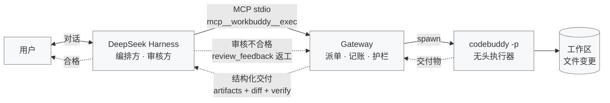
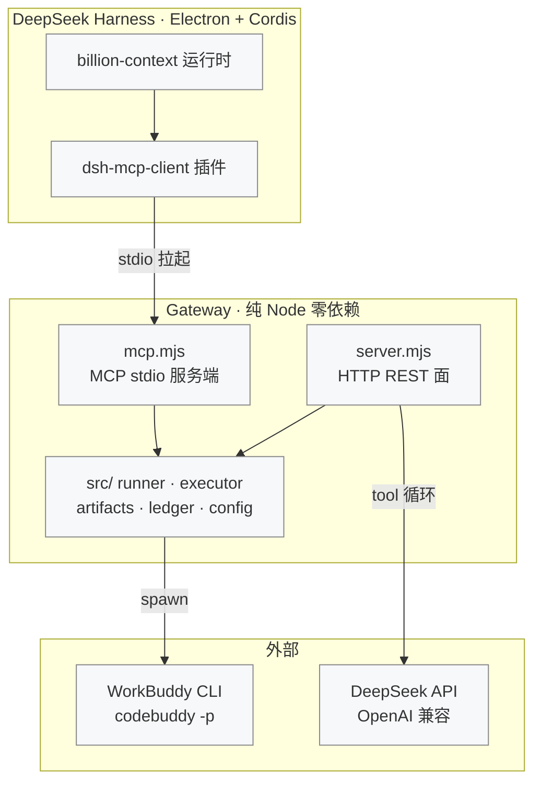

# DSH ⇄ WorkBuddy 网关

让 DeepSeek harness（DSH）把活派给 WorkBuddy 干，拿回**结构化交付物**去审核，不合格就带着意见退回返工。

## 架构



DSH 是编排方与审核方，Gateway 只负责三件事：**派单执行、交付物结构化、返工记账**。返工闭环：DSH 审核交付物，不合格就带 `review_feedback` 原 `session_id` 重派，服务端裁定轮次，3 轮封顶。

## 组件结构



两条接入面（MCP 与 REST/OpenAI 兼容面）**共用同一套核心**（`runner.mjs` / `ledger.mjs` / `artifacts.mjs`），护栏完全一致。任选其一，不要同时开（账本进程内存态会各持一份缓存）。

## 前置条件：一个 API Key（不需要登录）

**账号登录这条路在本机是死的**，原因有三层，都已实测：

1. 这个 WorkBuddy 构建只打包了 `dist/codebuddy-lite-wb.mjs`（精简产物），**交互界面起不来**——不带 `-p` 启动会静默退出（退出码 0，只打印一行 mod 日志）。`--acp`、`--serve` 同样静默退出。它实际上只支持 `-p` 无头模式。
2. CLI **没有 `login` 子命令**，`/login` 只是 TUI 里的斜杠命令，TUI 起不来就等于没有。
3. 桌面端的登录态不共享给 CLI，`~/.codebuddy` 里没有任何凭据。

**但不需要账号也能跑。** CLI 认这两个环境变量，走这条路时完全跳过账号登录：

| 变量 | 值 |
|---|---|
| `CODEBUDDY_API_KEY` | 你的密钥 |
| `CODEBUDDY_BASE_URL` | **OpenAI 兼容**端点，如 `https://api.deepseek.com/v1` |

> **base 必须是 OpenAI 兼容的版本根，不能填 `/anthropic`。** 我用假端点抓过实际报文：
> CLI 会在这个 base 后面直接拼 `POST /chat/completions`（`stream:true`、OpenAI 格式）。
> 填 `https://api.deepseek.com/anthropic` 就会拼成 `/anthropic/chat/completions` → **404**，
> 而这个 404 只出现在 stderr 里、CLI 仍然退出码 0 且 stdout 为空，很容易被误判成密钥问题。

一条命令配好并立刻验证：

```bash
node tools/set-key.mjs sk-xxxx
# 或自定义端点 + 模型：
node tools/set-key.mjs sk-xxxx https://api.deepseek.com/v1 deepseek-chat
```

它会把 `executor.apiKey / baseUrl / model` 写进 `config.json`，然后真跑一次「只回复两个字：收到」来验证——通了才算配置成功。

想改回账号登录模式，把 `executor.apiKey` 清空即可（前提是你自己解决了 CLI 登录）。

### 权限模式必须是 bypassPermissions

无人值守时 `dontAsk` / `acceptEdits` 会把**所有写操作判为 permission denied**——没有交互界面可以弹授权框，模型会「诚实地」报告：用了 Write / Bash / PowerShell 三种方式全部被拒。它甚至会把修复建议写进交付内容（用 `-y` 或 `bypassPermissions`），但那句话本身没法执行。

所以默认值是 `bypassPermissions`，安全性靠 `allowedTools` + workspace 白名单兜。见「安全边界」。

### 若在别的机器上 CLI 能登录：三个坑

| 坑 | 现象 | 原因 |
|---|---|---|
| PowerShell 引号 | `"D:\...\codebuddy"` 只打印路径，什么都不执行 | 引号把命令变成了字符串字面量，必须 `node <路径>` |
| 端口占用 | `EADDRINUSE ... (use --port <number>)` | CLI 启动必绑一个「稳定端口」，WorkBuddy 桌面端长期占着同一个 |
| 产物缺失 | `code: 'MODULE_NOT_FOUND'`，退出码 1 | 非 headless 时 `require('../dist/codebuddy')`，而该文件不存在 |

产物缺失的机制：`bin/codebuddy` 的分派是

```js
forceLiteWb ? import('codebuddy-lite-wb.mjs')
: isHeadless ? require('../dist/codebuddy-headless')
: require('../dist/codebuddy')          // ← 不存在
```

**只有 `forceLiteWb` / `isHeadless` 两条分支才走逐级回退**。桌面端拉起 CLI 时注入 `CODEBUDDY_FORCE_LITE_WB_BUNDLE=1`，脱离桌面端就得自己补——`src/executor.mjs` 的 `childEnv()` 已经内置，否则被 DSH 拉起时会重现同一个错。

### 已否决的两条路（省得再试）

- **桌面端网关当执行器**：`127.0.0.1:61860` 确实是已鉴权的 `CodeBuddy Gateway`（Bearer 用会话环境里的 `CODEBUDDY_GATEWAY_PASSWORD`），`POST /api/v1/runs` 能返回 202。但它有两个硬伤：① 密码只存在于运行中的进程环境里，没有落盘，重启即变；② 它的 ACP `session/new` 直接挂到当前活跃会话（实测返回的是你正在聊的 sessionId），`runs` 还带分钟级速率限制（连发 4 次就 `429 RATE_LIMITED`）。它是「遥控当前会话」的工具，不是独立执行器。
- **CLI 自己的 ACP / `--serve`**：`--acp --acp-transport streamable-http` 启动后端口没起来，进程静默退出。同一个产物裁剪问题。

## 快速开始

```bash
cp config.example.json config.json   # 复制模板并填好密钥、路径
node src/server.mjs --doctor   # 自检：CLI 路径、白名单、token
node src/server.mjs            # 启动，默认 127.0.0.1:8787
node smoke.mjs                 # 冒烟：让它建两个文件并回传 artifacts
```

> `config.json` 已被 `.gitignore` 排除，不会进仓库。从 `config.example.json` 复制一份，填好你自己的 API Key 和本机路径即可。

首次启动会自动生成 `config.json`（含随机 token）。

## 接口

除 `/healthz` 外都需要 `Authorization: Bearer <config.json 里的 token>`。

| 方法 | 路径 | 用途 |
|---|---|---|
| POST | `/v1/tasks` | 派单，阻塞到执行完成 |
| GET | `/v1/tasks?session_id=&limit=` | 查账 |
| GET | `/v1/tasks/{id}` | 单条任务全量记录 |
| GET | `/v1/tasks/{id}/raw?path=` | 取交付文件全文 |
| POST | `/v1/chat/completions` | OpenAI 兼容面，自动注入 `workbuddy_exec` 工具 |
| GET | `/healthz` | 健康检查（免 token） |

### 派单

```jsonc
{
  "task": "给 server.mjs 加 token 校验",       // 必填
  "acceptance_criteria": ["非法 token 返回 401", "不破坏 /healthz"],  // 强烈建议填
  "session_id": "s-01",                        // 同一任务的返工必须复用；省略则按任务文本指纹归并
  // attempt 不用传：网关自己数（= 该会话已完成轮次+1），客户端传的值只记录不采信
  "review_feedback": "上一轮漏了 401 的测试用例",  // 返工时必填
  "workspace": "D:/workbuddy",          // 必填，必须落在作用域白名单（scope.allowRoots）内
  "verify": { "command": "node --test" }        // 可选：执行完自动跑校验
}
```

返回：

```jsonc
{
  "task_id": "t-20261028142720-72a778",
  "session_id": "s-01",
  "attempt": 2,
  "status": "delivered",              // delivered | failed | timeout
  "output": "改了 X，验证方式是 Y…",     // 执行方的自述
  "artifacts": [
    { "path": "server.mjs", "change": "modified", "bytes": 8200,
      "diff_stat": "+38 -6", "preview": "…前 4000 字…" }
  ],
  "artifacts_total": 2,
  "diff_stat": "2 file(s) changed, +64 -6",
  "verify": { "command": "node --test", "exit_code": 0, "ok": true, "output_tail": "…" },
  "duration_ms": 84000
}
```

**审核看这几个字段就够了**：`diff_stat`（改了多少）、`artifacts[].diff_stat`（哪个文件改了多少）、`artifacts[].preview`（关键文件正文，≤8KB 的文件给全文）、`verify.ok`（客观信号）。

### 护栏

| 情况 | 返回 |
|---|---|
| 缺少 `acceptance_criteria` | `422 ACCEPTANCE_CRITERIA_REQUIRED` |
| 超出返工轮次 | `409 MAX_ATTEMPTS_EXCEEDED`，带 `status: "escalate"`，要求转人工 |
| 同一任务文本跨会话重跑 | `409 TASK_REPEAT_LIMIT`（累计达 2×上限时触发，防换 session 绕过） |
| workspace 越界 | `403 WORKSPACE_DENIED` |
| workspace 不在作用域（scope.allowRoots） | `403 WORKSPACE_SCOPE_DENIED` |
| CLI 未登录（且没配 apiKey） | `503 CLI_AUTH_REQUIRED` |
| 空交付（退出码 0 但没文本没文件） | `status: "failed"` + `EMPTY_RESULT` |
| 并发超限 | `429` |

`EMPTY_RESULT` 是必要的：模型/密钥/网络出错时 CLI 可能**退出码 0 且 stdout 为空**，只看退出码会记成 `delivered`，DSH 就会去审一份空交付——比直接报错更糟。

每个 4xx 响应都带一个 `next_action` 字段，内容是**写给模型看的指令**（告诉它下一步该怎么改），不只是给人看的报错。

默认 3 轮封顶。到第 4 轮网关直接拒绝——**自动返工超过三轮基本是在空转，该换人看**。

### 为什么 attempt 不能让客户端定

服务端裁定 `attempt = 该会话已完成轮次 + 1`。客户端传 `attempt: 1` 无效——否则「传 1 就能无限重开」是个一句话就能绕过的洞。

`session_id` 也做了兜底推导，优先级：

```
session_id > conversation_id > thread_id > task_key > sha1(任务文本前12位)
```

最后一级保证「同一段任务反复派」仍然落在同一会话里，轮次上限才真正生效。推导得出时，响应里会带 `session_warning` 提醒你下次显式传。

## DSH 不能注入系统提示词怎么办

> **走 MCP 的话这节可以跳过。** MCP 服务器的 `instructions` 会被 DSH 放进系统提示词，比下面三层都直接。三层仍然有效，是兜底。

**不需要系统提示词插件。** 纪律从三个地方下压，越往下越硬：

**第一层：工具描述。** `tools[].description` 是随每次请求发给模型的，任何支持 function calling 的 harness 都会原样转发。派单规则已经写进 `workbuddy_exec` 的描述里（见 `src/openai.mjs`），模型每轮都看得见。这一层替代了系统提示词，不需要 DSH 提供任何配置项。

**第二层：参数 schema。** `acceptance_criteria` 是 `required`，模型想省都省不掉；缺了服务端直接 422 拒收。

**第三层：服务端裁决。** 轮次、会话归并、跨会话重复，全由网关算。模型守不守规矩在结果上没区别——它绕不过去。

第三层是重点。前两层是「请它照做」，第三层是「它不照做也没用」。所以 4xx 响应里都塞了 `next_action`，用**给模型下指令的口吻**写——在拿不到系统提示词的情况下，这往往是它唯一的纠偏信号：

```json
{
  "error": { "code": "ACCEPTANCE_CRITERIA_REQUIRED", "message": "缺少 acceptance_criteria" },
  "next_action": "acceptance_criteria 是审核的唯一依据，不能省略。把任务拆成 2~5 条可逐条判定的检查项…补全后重新发起同一请求，session_id 保持不变。"
}
```

## 首选接法：MCP server（DSH 原生支持）

DSH 是 **Electron 应用 + Cordis 插件框架**（安装目录 `D:\ds`，配置目录 `~/.dsh`），自带 `@deepseek-ai/dsh-mcp-client`。所以不必绕 OpenAI 兼容层：

```
DSH（billion-context 运行时）
  └─ dsh-mcp-client  ──stdio──▶  gateway/mcp.mjs  ──spawn──▶  codebuddy CLI  ──▶  工作区
```

`mcp.mjs` 与 `server.mjs` **共用**同一套 `runner.mjs` / `ledger.mjs` / `artifacts.mjs`，护栏完全一致。

### 为什么这条路比注提示词更干净

MCP 服务器的 `instructions` 字段会被 DSH **作为字面文本放进系统提示词**（见 `dsh-mcp-client` 文档「服务器指令」一节）。也就是说：不需要「系统提示词插件」，派单纪律照样进系统提示词，而且随网关代码走，改纪律不用动 DSH 配置。

### 注册

```bash
node tools/register-dsh.mjs --check    # 只检查
node tools/register-dsh.mjs            # 写入（幂等，改前自动备份 + YAML 校验）
node tools/register-dsh.mjs --remove   # 撤销
```

写入 `~/.dsh/profiles/desktop/cordis.patch.yml`：

```yaml
- insert:
    - id: workbuddy-gateway
      name: '@deepseek-ai/dsh-mcp-client'
      config:
        serverName: workbuddy
        transport: stdio
        command: 'D:/Program Files/nodejs/node.exe'   # 必须绝对路径：DSH 会清洗子进程环境
        args: ['…/gateway/mcp.mjs']
        cwd: '…/gateway'
        toolCallTimeoutMs: 900000                     # 默认 60s，会把长任务掐断
        failOnStartupError: false
```

注册后重启 DSH，工具表里出现：

| 公开名 | 作用 |
|---|---|
| `mcp__workbuddy__exec` | 派单，回传 artifacts / diff_stat / verify |
| `mcp__workbuddy__history` | 查账本，上下文丢了也能捞回历次结论 |

### 自测（不依赖 DSH）

```bash
node tools/mcp-test.mjs     # 协议 7 项：握手 / 工具表 / 缺标准拒收 / 真实派单 / 未知方法
node tools/scrub-test.mjs   # 按 dsh-mcp-client 的规则清洗环境后再派一次
```

`mcp-test.mjs` 实测输出（CLI 未登录时的预期形态）：

```
1) initialize  protocol=2026-07-28  instructions=605字
2) tools       exec, history
3) history ok
4) exec 缺 acceptance_criteria → isError=true code=ACCEPTANCE_CRITERIA_REQUIRED
5) exec 真实派单 → isError=true code=CLI_AUTH_REQUIRED
```

### 验证 DSH 是否真的加载了

```powershell
# 找出跑 mcp.mjs 的子进程，有就说明挂载成功
Get-CimInstance Win32_Process -Filter "Name='node.exe'" |
  Where-Object { $_.CommandLine -like '*mcp.mjs*' } |
  Select-Object ProcessId,ParentProcessId,CommandLine
```

或者直接在 DSH 里问它有哪些工具。

### 两条通路只能选一条

`Ledger` 在启动时把整个账本读进内存，**两个进程各持一份缓存**。同时开 `server.mjs`（REST）和 DSH 里的 `mcp.mjs`，两边都会算轮次，`attempt` 可能互相覆盖。

走 MCP 时就不要另外起 `server.mjs`。需要 REST 时用 `--remove` 撤掉 MCP 条目。

## DSH 侧怎么接（非 MCP 场景）

### 方式一：直接调 REST（推荐，你就是编排方）

你已经有自己的 agent loop。**能改提示词就最好**，照抄下面这段进 system prompt，行为最可预测：

```
你有 workbuddy_exec 能力，通过本地网关调用。派单纪律：
1. 每次派单必须给出 acceptance_criteria，逐条可判定，禁止模糊表述
2. 审核时逐条比对 acceptance_criteria + artifacts[].preview + verify.ok
3. 不合格 → 带 review_feedback 再派一次，session_id 保持不变
4. 返工超过 2 次仍在同一个点上失败 → 停止，把问题呈报用户，不要继续猜
5. 审核结论只认证据：不要相信 output 里的自述，要看 artifacts 里的实际内容
6. 完成后向用户汇报：改了什么、证据是什么、遗留什么
```

不能改也没关系——上面那三层会替你兜住，只是模型未必一次就把 `acceptance_criteria` 写得好，可能会多浪费几个 422。

第 5 条是关键。`output` 是执行方自己说的，`artifacts` 才是事实。

### 方式二：OpenAI 兼容面

把你的 `base_url` 指到 `http://127.0.0.1:8787/v1`，网关会自动注入 `workbuddy_exec` 工具并在服务端完成 tool 循环。适合原生支持 function calling 的 SDK，你这边代码几乎不用改。

需要先在 `config.json` 填 `deepseek.apiKey`（或设环境变量 `DEEPSEEK_API_KEY`）。

> 注：`stream: true` 目前是伪流式（内部一次性算完再分块下发），因为 tool 循环本身无法真流式。

## 安全边界（请读完）

- 网关只监听 `127.0.0.1`，不对局域网开放
- token 校验是必须的，但**它不是强隔离**——能读 config.json 的本机进程都能拿到
- `workspace` 白名单是**网关层的准入**，不是操作系统级沙箱。既然执行器跑的是 `bypassPermissions`，WorkBuddy 理论上仍可访问白名单外的路径（尤其经 `Bash`）
- 真要硬隔离：让 WorkBuddy 跑在容器里，或换独立系统用户，网关只连容器暴露的端口
- `permissionMode` 默认 `bypassPermissions`，这是**为了能干活而必须付出的代价**：`dontAsk` / `acceptEdits` 在无人值守下会把所有写操作判成 permission denied。如果只想让它改代码、不想要 `Bash`，把 `allowedTools` 里的 `Bash` 去掉（代价是跑不了测试）

## 已知限制

- CLI 每个任务起一个进程，冷启动约 3~5 秒；高频场景可改 `--serve` 长驻（`executor.extraArgs` 里加，需自行改 `executor.mjs`）
- 跨轮次的上下文靠 prompt 回灌（上一轮 output + review_feedback），不依赖 CLI 的 session resume，行为可预测但每轮都会重读任务描述
- 会话归并的最后一级是任务文本指纹，**改写措辞会被当成新任务**。要跨措辞延续同一轮次，必须显式传 `session_id`
- `artifacts` 最多回传 40 个文件，其余用 `/v1/tasks/{id}/raw` 逐个取
- diff 行数依赖 git 基线；工作区不是 git 仓库时只统计文件数，行数会标「无 git 基线」
- **单次任务的输入 token 很大**：实测系统提示 + 工具定义约 2.2 万 input tokens。DeepSeek 按量计费时，一次简单任务也要算这么多，长任务成本要按轮次估
- `--output-format json` 输出的**是事件数组**，不是单个结果对象：

  ```jsonc
  [ {type:"message",role:"user",…},
    {type:"ai-title",…},
    {type:"message",role:"assistant",…},
    {type:"result",subtype:"success",is_error:false,result:"收到",session_id:"…",usage:{…}} ]
  ```

  真正的回答在最后那个 `type:"result"` 的 `result` 字段里。`parseResult()` 已按这个结构解析；
  如果哪天升级 CLI 后交付内容变成一大段原始 JSON，就是这里又变了

## 目录

```
gateway/
├── mcp.mjs             # MCP stdio 服务端（DSH 直接拉起，stdout 只跑协议）
├── config.json         # 首次启动自动生成（token、白名单、执行器参数）
├── src/
│   ├── server.mjs      # HTTP 路由、鉴权、并发闸
│   ├── runner.mjs      # 一次派单的完整流程：快照→执行→diff→记账
│   ├── executor.mjs    # CLI 参数拼装、子进程、结果解析
│   ├── artifacts.mjs   # 目录快照、变更检测、预览与 diff 统计
│   ├── openai.mjs      # OpenAI 兼容面 + tool 循环
│   ├── ledger.mjs      # 任务账本（JSON 落盘 + events.jsonl）
│   ├── config.mjs      # 配置加载与 CLI 自动探测
│   └── util.mjs
├── tools/
│   ├── register-dsh.mjs  # 注册/撤销 DSH 的 MCP 条目（幂等 + 备份 + YAML 校验）
│   ├── set-key.mjs       # 写入 API Key 并立刻真跑一次验证
│   ├── mcp-test.mjs      # MCP 协议冒烟
│   ├── scrub-test.mjs    # 按 DSH 清洗规则复测
│   ├── api-probe.mjs     # 假模型端点：抓 CLI 实际请求的路径与报文
│   ├── cli-login.mjs     # 账号登录启动器（本机构建走不通，留作其它机器备用）
│   └── asarx.mjs         # 只读 asar 解包（用来查 DSH 内部实现）
├── probe.mjs           # 出站能力诱捕探针
├── smoke.mjs
└── .gateway/           # 运行时数据：ledger/、events.jsonl
```
